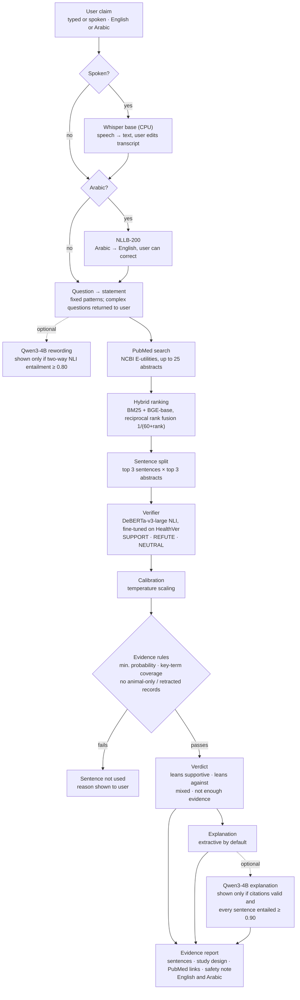
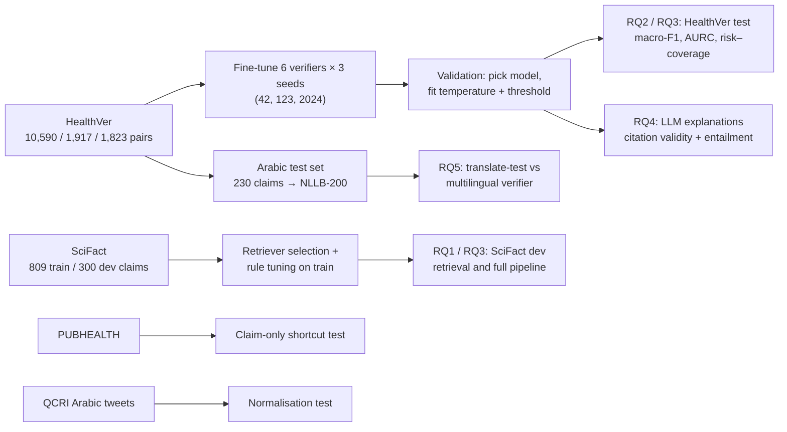

# MIZAN-Med

**Evidence grounded health claim verification with calibrated abstention and a cross lingual Arabic evaluation**

MIZAN-Med checks a short health claim, typed or spoken in English or Arabic, against research abstracts from PubMed. It shows the exact sentences behind its answer and the study design they come from, and it gives a verdict only when the evidence and the model's calibrated confidence are strong enough. Otherwise it reports that there is not enough evidence. The name comes from the Arabic word *mizan* (ميزان), meaning balance or scale.

> **Research prototype only. This is not medical advice.** Verdicts and translations can be wrong. Do not enter personal health information.

Group project for **MAAI 902: Natural Language Processing and LLMs**, University of Wollongong in Dubai, 2026.

| | |
|---|---|
| **Demo video** | [Watch on Google Drive](https://drive.google.com/file/d/1AS1sIaq-9OZkurno-vvJr58rUKQBEHGg/view?usp=drive_link): typed English and Arabic claims and the Whisper speech input on the live website |
| **Final executed notebook** | [`MIZAN_Med_Hala_speech.ipynb`](https://colab.research.google.com/drive/12RItlK_TSLlOtj1jebWsIeRzPWjx23tI#scrollTo=mizan-51)) |
| **Technical report** | [`MIZAN-Med_Assessment3_Report_Final.docx`](https://github.com/halakhalid8991/MIZAN-Med_MAAI902_Groupproject/blob/main/MIZAN-Med_Assessment3_Report_Final.docx) |
| **Datasets and review files** | [Project Google Drive folder](https://drive.google.com/drive/folders/1ScUzF-NM8kCJgKGTWjLX0eu47k-jAVHx?usp=drive_link) |

---

## Architecture

### Pipeline

How a claim travels through MIZAN-Med, from input to an answer or an honest abstention:



**Hallucination safeguards.** The verdict always comes from the fine-tuned verifier reading real PubMed sentences, never from the LLM. Generated text is optional: a rewording is used only if it keeps the meaning (two-way entailment ≥ 0.80), and an explanation is shown only if every cited PubMed ID was retrieved and every sentence is entailed by the cited evidence (≥ 0.90). Otherwise the user sees the extracted evidence sentence. When the evidence is weak, the system answers "not enough evidence" instead of guessing.

### Pipeline figure (as in the paper)


### Components

| Stage | Component | Model or tool | Code module |
|---|---|---|---|
| Input | Speech to text | `openai/whisper-base`, CPU, 30 s, nothing saved | `mizan_website.py` |
| Input | Arabic → English | NLLB-200 (OPUS-MT also evaluated) | `mizan_core.py` |
| Retrieve | Evidence search | NCBI E-utilities (PubMed) | `mizan_core.py` |
| Retrieve | Ranking | BM25 (`rank_bm25`) + `BAAI/bge-base-en-v1.5`, reciprocal rank fusion | `mizan_core.py` |
| Verify | Claim–sentence NLI | `MoritzLaurer/DeBERTa-v3-large-mnli-fever-anli-ling-wanli`, fine-tuned on HealthVer | `mizan_core.py` |
| Abstain | Calibration and threshold | Temperature scaling; threshold at 90% selective accuracy on validation | `mizan_core.py` |
| Abstain | Evidence rules | Tuned by a 1,200-combination grid on 400 SciFact training claims | `mizan_research.py` |
| Explain | Rewording and explanation | `Qwen/Qwen3-4B-Instruct-2507`, run locally | `mizan_llm.py` |
| Explain | Grounding check | Independent DeBERTa-v3-base NLI cross-encoder | `mizan_llm.py` |
| Output | Bilingual web interface | Gradio 4.44 | `mizan_website.py` |

### Evaluation set-up (offline, in the notebook)



## Speech input

The website also accepts spoken claims. Open **🎙️ Speak your claim · تسجيل الادعاء**, choose Auto detect, English or Arabic, record up to 30 seconds, stop, and press **Transcribe recording**. The multilingual `openai/whisper-base` model transcribes the recording on the CPU, so it does not compete with the verifier for GPU memory. The transcript is added to the claim box and does not start the check automatically, so it can be corrected first.

* The first transcription downloads the Whisper model and can take a few minutes.
* Recordings are processed on the server hosting the demo and are not saved to project files; Gradio may keep temporary audio files during a session.
* Another multilingual Whisper model can be used by setting `MIZAN_SPEECH_MODEL`. Do not use an English only model for Arabic.
* This is a usability feature. It was tested informally and is **not** part of the reported evaluation.

## Main results

All numbers are produced by the notebook; nothing is hard coded. The table reports the first full run (`MIZAN_Med_v0_6_2.ipynb`), which the report's Tables 6–9 use.

| Research question | Result |
|---|---|
| **RQ1 Retrieval** (SciFact dev) | Dense BGE-base found a relevant abstract in the top 10 for **96.2%** of claims (nDCG@10 0.878); equal weight fusion with BM25 lowered it to 0.854 |
| **RQ2 Verification** (HealthVer test, 1,823 pairs) | DeBERTa-v3-large NLI reached **0.817 ± 0.003** macro F1 over 3 seeds, against 0.647 for TF-IDF and 0.561 for zero shot Qwen3-4B |
| **RQ3 Abstention, single pairs** (HealthVer test, second run) | The validation threshold answered **88.7%** of pairs at **86.8%** accuracy (82.7% when answering all); temperature scaling cut calibration error (ECE) from 0.144 to 0.055 |
| **RQ3 Abstention, full pipeline** (SciFact dev, 300 held out claims) | Tuned evidence rules answered **45.3%** of claims at **73.5%** accuracy; without rules 56.7% at 66.5%; the earlier hand set rules answered none |
| **RQ4 Explanations** | All LLM explanations cited valid PubMed IDs, but only **16.8%** were entailed by the evidence they cited |
| **RQ5 Arabic** (same 1,823 pairs) | Translate test with NLLB-200 lost **1.2** points of macro F1 (not significant), OPUS-MT 2.4, and a multilingual verifier reading Arabic directly 4.0 |

A native Arabic speaker reviewed the 61 claims whose prediction changed under NLLB-200 translate-test (seed 42 of the second run): 42 (68.9%) kept their meaning in translation, 15 (24.6%) shifted in meaning and 4 (6.6%) lost a negation, so translation errors explain about one third of the changed verdicts. NLLB-200 both created the Arabic claims and translated them back, so the 1.2-point gap is best read as a lower bound.

**Second run.** The full notebook was run a second time on another machine (`MIZAN_Med_Hala_speech_final.ipynb`). The verifier scored 0.821 instead of 0.817, and every main conclusion held. Some numbers differ between the runs because GPU training is not fully deterministic. In particular, re-tuning the evidence rules chose stricter values: minimum probability 0.80, similarity 0.50 and no term rule, compared with 0.60 and 25% of key terms in the first run. These rules answered **38.7%** of SciFact claims at **81.9%** accuracy. The demo website loads the rule file and verifier from this final run.

## Repository contents

| File or folder | Contents |
|---|---|
| `MIZAN_Med_Hala_speech_final.ipynb` | **Final executed notebook** (second full run, verifier macro F1 0.821): data audit, baselines, training, evaluation, ablations, the single-pair calibration figures and confusion matrix, the native-speaker review of the 61 changed Arabic predictions, and the website with speech input. The demo and the report's Figure 4b and Sections 5.4 and 5.7 come from this run |
| `MIZAN_Med_v0_6_2.ipynb` | First full executed run. The report's Tables 6–9 and this README's main results come from this run |
| `mizan_core.py` | Data loading, retrieval (BM25 + BGE-base, reciprocal rank fusion), verifier, calibration and evidence rules |
| `mizan_research.py` | Experiments: baselines, fine-tuning over three seeds, evaluation, rule tuning, ablations and the Arabic evaluation |
| `mizan_llm.py` | Qwen3-4B rewording, zero-shot baseline, explanations and the NLI grounding check |
| `mizan_website.py` | Gradio website, including the Whisper speech input |
| `figures/pipeline.png` | Pipeline figure (the same figure as in the paper) |
| `requirements.txt` | Pinned library versions (the same as the notebook's install cell) |
| `MIZAN-Med_Assessment3_Report_Final.docx` | Assessment 3 technical report (final version) |

The four `.py` modules are the files the notebook writes with `%%writefile` when it runs; they are included so the code can be read and reviewed without opening the notebook.

The dataset bundle (`MIZAN_Med_Datasets.zip`, with `MANIFEST.json` holding the SHA-256 checksums, sources and licences) and the human review files (`MIZAN_Med_Review_Files.zip`) are kept in the project Google Drive folder, not in this repository:

**[MIZAN-Med Google Drive folder](https://drive.google.com/drive/folders/1ScUzF-NM8kCJgKGTWjLX0eu47k-jAVHx?usp=drive_link)**

They are shared for academic assessment only (see [Datasets](#datasets)).

## Running the notebook

### Google Colab (recommended)
1. Open `MIZAN_Med_Hala_speech_final.ipynb` in Colab and choose a GPU runtime (an NVIDIA L4 was used; a T4 also works, but more slowly).
2. Download `MIZAN_Med_Datasets.zip` and `MIZAN_Med_Review_Files.zip` from the [project Google Drive folder](https://drive.google.com/drive/folders/1ScUzF-NM8kCJgKGTWjLX0eu47k-jAVHx?usp=drive_link) and put them in **My Drive/MIZAN-Med** (or upload them when the notebook asks). Keep them zipped.
3. Run the cells from the top. After the first install cell, restart the session (**Runtime → Restart session**) and run all cells again.
4. In **Experiment controls**, set `EXPERIMENT_MODE = 'SMOKE'` for a quick test or `'FULL'` for the reported results. SMOKE outputs are never valid results.
5. Run **Start the website** last. It prints a temporary `gradio.live` link, valid for 72 hours. Open the link (not `localhost`) and allow microphone access to use the speech input.

To open only the website after a FULL run, run the setup cells (environment, install, workspace, the four `%%writefile` cells and the module import), skip the experiments, and run **Start the website**. The trained verifier is loaded from Drive.

Finished training runs are saved to Drive and reused, so an interrupted run can be resumed by running the cells again.

### Own computer
Install PyTorch with CUDA first, then run the notebook in Jupyter. Set the project folder before starting, for example:

```bash
export MIZAN_PROJECT_DIR="/path/to/MIZAN-Med"     # Windows: set MIZAN_PROJECT_DIR=C:\path\to\MIZAN-Med
```

### Main libraries
PyTorch, Hugging Face `transformers` (≥4.51, <5), `datasets` 3.6.0, `sentence-transformers` 3, `rank_bm25`, scikit-learn, SciPy, `sacrebleu`, `gradio` 4.44.1 (Whisper speech input through the `transformers` pipeline and `scipy` for resampling). Exact versions are pinned in the install cell.

## Datasets

The datasets are **not stored in this repository**. They were downloaded from their official sources and are checked against SHA-256 checksums before loading. They are shared through the [project Google Drive folder](https://drive.google.com/drive/folders/1ScUzF-NM8kCJgKGTWjLX0eu47k-jAVHx?usp=drive_link) only so that the work can be assessed and reproduced for the MAAI 902 subject. They remain the property of their authors, must be cited, and must not be reused or redistributed outside the terms of each licence below.

| Dataset | Role | Licence | Source |
|---|---|---|---|
| HealthVer | Train and test the verifier; Arabic test set | No licence stated; used for research only and not redistributed | https://github.com/sarrouti/HealthVer |
| SciFact | Retrieval, rule tuning, end to end test | CC BY 4.0 (claims), ODC-By 1.0 (abstracts) | https://github.com/allenai/scifact |
| PUBHEALTH | Claim only shortcut test | MIT | https://github.com/neemakot/Health-Fact-Checking |
| QCRI COVID-19 Disinformation (Arabic) | Arabic text normalisation test | CC BY-NC-SA 4.0 | https://huggingface.co/datasets/QCRI/COVID-19-disinformation |

AraCOVID19-MFH and PubMedQA were screened but excluded (tweet IDs only; question answering rather than claim verification).

## Models used

| Component | Model |
|---|---|
| Verifier | `MoritzLaurer/DeBERTa-v3-large-mnli-fever-anli-ling-wanli`, fine tuned on HealthVer |
| Multilingual verifier | `MoritzLaurer/mDeBERTa-v3-base-xnli-multilingual-nli-2mil7`, fine tuned on HealthVer |
| Retrieval | BM25 + `BAAI/bge-base-en-v1.5` |
| Translation | NLLB-200 and OPUS-MT |
| LLM | `Qwen/Qwen3-4B-Instruct-2507`, run locally |
| Independent checker | DeBERTa-v3-base NLI cross encoder |
| Speech input | `openai/whisper-base` (multilingual), run on the CPU |

## Limitations

* HealthVer covers COVID-19 only, so other health topics are untested.
* The Arabic claims are machine translated Modern Standard Arabic, not real or dialectal rumours.
* The evidence rules were tuned on SciFact, not on live PubMed, and no user study has been carried out.
* LLM explanations were checked automatically, not by human reviewers.
* The speech input was tested only informally; its accuracy on Arabic, and especially Gulf dialect, has not been measured.
* NLLB-200 and the QCRI data are licensed for non commercial use only, so the system as built is for research use only.

## Future work

* Real Arabic and Gulf dialect health rumours, and a formal test of the speech input on them.
* A second, independent judge from a different model family to assess the faithfulness of each explanation alongside the NLI check.
* Human review of the LLM explanations, and a user study with clinicians and members of the public.

## Team

| Member | Student ID |
|---|---|
| Hala Khalid Sarhan | 5080307 |
| Nourhanne Abdelaziz | 1113173 |
| Mohamed Sakr | 7299163 |
| Harley Douti-Mama | 1048338 |
| Sanzhar Seisenov | 7556457 |

Instructor: Dr. Pallavi Ranjan.

## Use of generative AI

Generative AI tools, including Claude (Anthropic), assisted with code development, debugging and the editing of the report and this README, as permitted by Section 5.2 of the subject outline. Prompt histories can be provided on request. All experiments were run by the team, and all results were checked against the notebook outputs.

## Citation

If you use this work, please cite the datasets and models listed above, and:

```
H. K. Sarhan, N. Abdelaziz, M. Sakr, H. Douti-Mama and S. Seisenov, "MIZAN-Med: Evidence-grounded health claim
verification with calibrated abstention and a cross-lingual Arabic evaluation," MAAI 902 group project,
University of Wollongong in Dubai, 2026.
```
